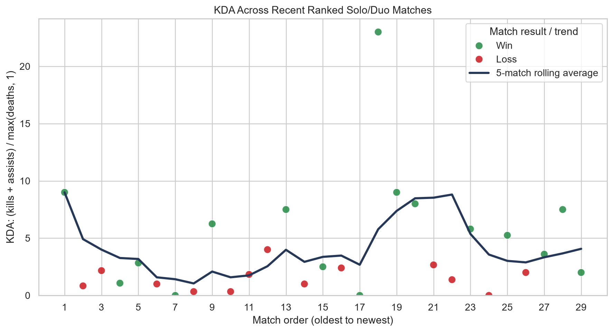
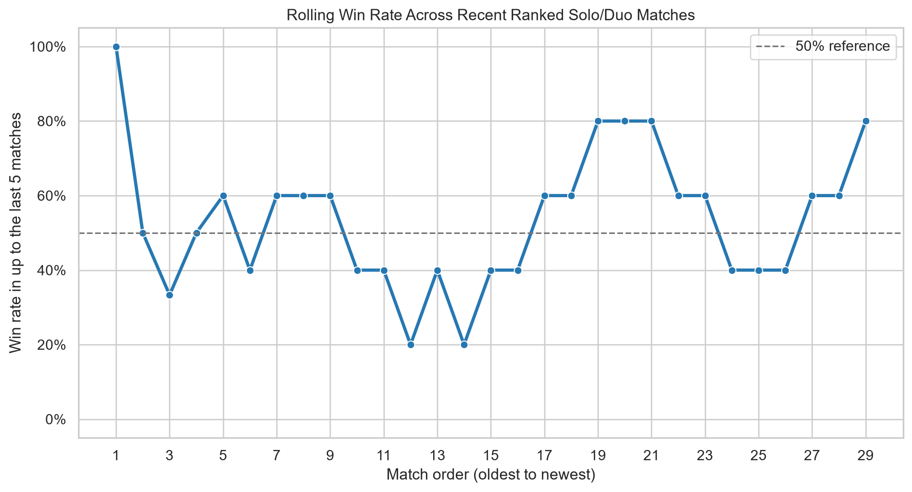

# From Riot API to Match Statistics: A Python Walkthrough

League of Legends match history is a useful example of a common data-science task: data are available through an API, but they arrive as nested JSON rather than as a tidy table. In this tutorial, we will use Python to request recent League of Legends match data, keep only Ranked Solo/Duo games, calculate KDA and win rate, and plot how those statistics change across matches.

You will need a Riot developer API key and the Python packages `requests`, `pandas`, `matplotlib`, and `seaborn`. Install the packages with:

```bash
pip install requests pandas matplotlib seaborn
```

## Keep your API key out of your code

An API key identifies your requests to Riot. Treat it like a password: do not post it in a public repository, blog, screenshot, or shared notebook. Riot’s [developer documentation](https://developer.riotgames.com/docs/lol) says API keys should not be included in code. If a key has already been shared, revoke it in the Developer Portal and create a fresh one.

Store your new key in an environment variable. On macOS or Linux, you can set it in a terminal before running your script:

```bash
export RIOT_API_KEY="paste-your-new-key-here"
```

Then read it in Python and add it to the request header:

```python
import os
import requests

api_key = os.getenv("RIOT_API_KEY")
if not api_key:
    raise RuntimeError("Set the RIOT_API_KEY environment variable first.")

session = requests.Session()
session.headers.update({"X-Riot-Token": api_key})
```

The session reuses this header for authenticated API calls, so you do not have to attach the key to every URL.

The tutorial uses three Riot endpoints:

| Endpoint | Route | What it provides |
| --- | --- | --- |
| Account-V1: account by Riot ID | `/riot/account/v1/accounts/by-riot-id/{gameName}/{tagLine}` | Converts a Riot ID into the PUUID used by match-history endpoints. |
| Match-V5: match IDs by PUUID | `/lol/match/v5/matches/by-puuid/{puuid}/ids` | Returns recent match IDs; `start` and `count` select a page of results. |
| Match-V5: match by ID | `/lol/match/v5/matches/{matchId}` | Returns the full match JSON, including the participant statistics. |

These routes are appended to a regional API host such as `https://americas.api.riotgames.com`.

## Look up a player and their match IDs

Riot IDs have a game name and a tag line. The Account API converts those two pieces into a PUUID, Riot’s stable player identifier. For the Americas routing cluster, the account lookup endpoint looks like this:

```python
from urllib.parse import quote

region = "americas"
game_name = "your-game-name"
tag_line = "your-tag"

account_url = (
    f"https://{region}.api.riotgames.com/riot/account/v1/accounts/"
    f"by-riot-id/{quote(game_name, safe='')}/{quote(tag_line, safe='')}"
)
response = session.get(account_url, timeout=30)
response.raise_for_status()
puuid = response.json()["puuid"]
```

`quote` safely encodes spaces and special characters in a Riot ID. The `raise_for_status()` call stops the script with an error if the request fails, instead of letting later code fail in a confusing way. Use the regional routing value that matches the account and endpoint; Riot lists routing values in its [API documentation](https://developer.riotgames.com/docs/lol#routing-values).

Next, request match IDs. This endpoint returns identifiers, not the full match statistics. The `count` parameter is capped at 100 per request, so this example asks for 50 recent games:

```python
match_ids_url = (
    f"https://{region}.api.riotgames.com/lol/match/v5/"
    f"matches/by-puuid/{puuid}/ids"
)
response = session.get(
    match_ids_url,
    params={"start": 0, "count": 50},
    timeout=30,
)
response.raise_for_status()
match_ids = response.json()
```

Each match ID needs a separate Match API request to retrieve its full record. That means 50 IDs can lead to 50 more requests. The finished script pauses between match requests and waits before retrying if Riot returns a rate-limit response. Keeping the sample to a manageable size makes a tutorial run quicker and gentler on the API.

## Turn nested JSON into one row per match

A match response contains a list of ten participants under `info["participants"]`. `pandas.json_normalize()` turns that list of dictionaries into columns. We request each match, select the row whose PUUID matches our player, and add match-level fields such as the queue and creation time:

```python
import time
import pandas as pd

rows = []
for match_id in match_ids:
    match_url = (
        f"https://{region}.api.riotgames.com/lol/match/v5/matches/{match_id}"
    )
    response = session.get(match_url, timeout=30)
    response.raise_for_status()
    match = response.json()
    info = match["info"]

    participants = pd.json_normalize(info["participants"])
    player_row = participants.loc[participants["puuid"].eq(puuid)].copy()
    if not player_row.empty:
        player_row["matchId"] = match["metadata"]["matchId"]
        player_row["gameMode"] = info["gameMode"]
        player_row["queueId"] = info["queueId"]
        player_row["gameCreation"] = info["gameCreation"]
        rows.append(player_row)

    time.sleep(1.2)  # pause between requests

if not rows:
    raise RuntimeError("No participant rows were returned.")
matches = pd.concat(rows, ignore_index=True)
```

The result is a rectangular DataFrame: each row is one match for the selected player, and each column is a match statistic or identifier. The complete script also handles HTTP errors and waits before retrying when Riot returns a rate-limit response.

## Clean the matches and calculate statistics

The API returns multiple modes and queues. This project focuses on Ranked Solo/Duo, identified by queue ID `420`; Riot’s [queue list](https://static.developer.riotgames.com/docs/lol/queues.json) describes it as 5v5 Ranked Solo. The `CLASSIC` check keeps the Summoner’s Rift game mode. After filtering, remove duplicate or incomplete rows and sort by creation time so the first row is the oldest match.

```python
ranked = matches.loc[
    matches["gameMode"].eq("CLASSIC") & matches["queueId"].eq(420)
].copy()
ranked = ranked.drop_duplicates("matchId").dropna(
    subset=["gameCreation", "kills", "deaths", "assists", "win"]
)
ranked = ranked.sort_values("gameCreation").reset_index(drop=True)

ranked["match_number"] = range(1, len(ranked) + 1)
ranked["match_kda"] = (
    ranked["kills"] + ranked["assists"]
) / ranked["deaths"].clip(lower=1)
ranked["rolling_kda"] = ranked["match_kda"].rolling(5, min_periods=1).mean()
ranked["rolling_win_rate"] = ranked["win"].astype(float).rolling(
    5, min_periods=1
).mean()
```

KDA is `(kills + assists) / deaths`. The `.clip(lower=1)` guard treats a match with zero deaths as a denominator of 1, avoiding division by zero. The rolling calculations summarize the current match and up to the previous four matches; the first few points use fewer than five games. The overall win rate is `ranked["win"].mean()` because a Boolean column averages to the proportion of `True` values.

## Plot performance over time

The script creates two Seaborn plots. The first is a scatter plot of each match’s KDA, with color indicating a win or loss. A line overlays the five-match rolling KDA average. The second is a line chart of rolling win rate, with a dashed 50% reference line. In both, the x-axis uses match order from oldest to newest, making recent performance easy to find at the right side.

These charts answer different questions. The scatter plot shows how much KDA varies from game to game, while its rolling line makes the broader pattern easier to see. The win-rate plot smooths individual outcomes so one win or loss does not dominate the story. Neither chart proves that a player is improving; a short run of matches can be noisy, and KDA or win rate does not capture every contribution to a game.

Here are example outputs from the script. In the first chart, green points are wins and red points are losses; the dark line is the rolling KDA average. In the second, the blue line shows the win rate across up to the most recent five matches, and the dashed line marks 50%.



*Figure 1. Match-by-match KDA and its five-match rolling average.*



*Figure 2. Win rate across up to the most recent five matches.*

Here is the core Seaborn code for the two views. It expects the cleaned `ranked` DataFrame from the previous section:

```python
import matplotlib.pyplot as plt
import seaborn as sns

sns.set_theme(style="whitegrid")
fig, axes = plt.subplots(2, 1, figsize=(10, 9))

sns.scatterplot(
    data=ranked, x="match_number", y="match_kda", hue="result",
    palette={"Win": "#238b45", "Loss": "#cb181d"}, ax=axes[0]
)
sns.lineplot(
    data=ranked, x="match_number", y="rolling_kda",
    color="#253858", label="5-match rolling average", ax=axes[0]
)
axes[0].set(title="KDA by Match", xlabel="Oldest → newest", ylabel="KDA")

sns.lineplot(
    data=ranked, x="match_number", y="rolling_win_rate",
    marker="o", ax=axes[1]
)
axes[1].axhline(0.5, linestyle="--", color="gray", label="50% reference")
axes[1].set(title="Rolling Win Rate", xlabel="Oldest → newest", ylabel="Win rate")
axes[1].set_ylim(0, 1)

fig.tight_layout()
plt.show()
```

## Try it with your own match history

Set your Riot ID and routing cluster in the script, then run it with a fresh API key in the environment. Check that the resulting DataFrame contains only the player’s Ranked Solo/Duo matches before interpreting the plots. As a next step, change the rolling window from five to ten matches and compare how the trend line changes. For details about endpoints and current API guidance, use Riot’s [League of Legends API documentation](https://developer.riotgames.com/docs/lol).
